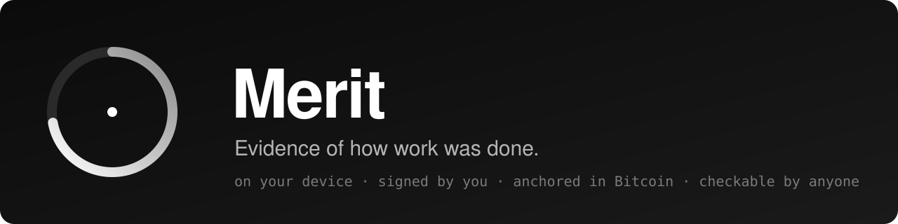
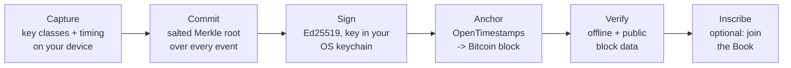

<p align="center">
  
</p>

<p align="center">
  <a href="https://github.com/nebulamji/merit/actions/workflows/build.yml"></a>
  <a href="LICENSE"></a>
  
  
  
</p>

<p align="center">
  <b><a href="https://merit.artofficial.computer">Website &amp; the Book</a></b> ·
  <b><a href="docs/WHITEPAPER.md">Paper</a></b> ·
  <b><a href="docs/SPEC.md">Spec</a></b> ·
  <b><a href="#install">Install</a></b> ·
  <b><a href="#quick-start">Quick start</a></b> ·
  <b><a href="CONTRIBUTING.md">Contribute</a></b>
</p>

---

## Why Merit

When machines can produce the output, the output stops proving ability. **Merit records the *process*** (corrections, revisions, continuity, pastes, time) on your own device, signs it with a key only you hold, and anchors it to Bitcoin. Anyone can check the result. Nobody has to trust anyone.

Anti-cheating tools ask *"did a human write this?"* about one document. Merit keeps answering *"how does this person work?"* across everything they make: a record that compounds.

| | |
|---|---|
| **First-party** | You attest your own work. No one records anyone else. |
| **Private by construction** | Raw keystrokes never leave your device. Capture stores the *class* of each key (letter, space, back, paste…) and its timing, never the character. |
| **Yours** | Your signing key is generated on your machine. Certificates are files you hold and choose to share. |
| **Checkable** | A certificate verifies offline (signature, content id, document hash, any edit you disclose). Its anchor verifies against public Bitcoin block data. |

## How it works



## Install

Download the installer for your computer from the [latest release](https://github.com/nebulamji/merit/releases/latest). No Node, no toolchain.

| System | Installer | First run |
|---|---|---|
| **macOS** (Apple Silicon and Intel) | `.dmg` | Right-click → Open (the build is unsigned). Allow it under *System Settings → Privacy & Security → Input Monitoring*. |
| **Windows** | `.msi` or `.exe` | *More info → Run anyway* (unsigned). |
| **Linux** | `.AppImage` or `.deb` | X11 session required for the global recorder. |

On Wayland, or anywhere you cannot install an app, use the [terminal recorder](packages/term) or the [CLI](#quick-start): both run on any machine with Node 22 or Python 3.

**Use it.** Menu bar → **Measure integrity**, write in any app on your list (`~/.merit/apps.json`), then **Stop &amp; sign**. The app signs with your keychain key (Keychain, Credential Manager or Secret Service, never shown to the page) and submits to Bitcoin; a few hours later it confirms on its own. Isolated mode for tests or portable use: `MERIT_HOME=/some/dir merit-menubar` never touches the system keychain.

## Quick start

```bash
pnpm install && pnpm test
# record yourself directing an agent in the terminal
python3 packages/term/merit_term.py rec --app claude -- claude
# sign it and anchor it
node dist/merit-cli.cjs certify ~/.merit/sessions/<session>.jsonl --stamp
node dist/merit-cli.cjs verify ~/.merit/sessions/<session>.cert.json
# hours later, once a Bitcoin block includes it
node dist/merit-cli.cjs upgrade ~/.merit/sessions/<session>.cert.json.ots
```

Build the CLI bundle: `pnpm exec esbuild packages/verify/src/cli.ts --bundle --platform=node --format=cjs --external:@napi-rs/keyring --outfile=dist/merit-cli.cjs`.

## What is in this repository

| Package | Does |
|---|---|
| `packages/spec` | `merit-attestation/0.1` format, canonical JSON + sha256 content ids, event models (`MeritEvent` for editors, `KeyEvent` for devices) |
| `packages/capture` | Replay a log to the exact final text; derive metrics: corrections by class, revisions, bursts, pauses, paste share, **forgiveness** (corrections recovered from) |
| `packages/attest` | Ed25519 self-custody keys, signed certificates, salted Merkle commitment over every edit, single-edit disclosure proofs |
| `packages/verify` | Offline verifier, OpenTimestamps stamping/upgrade/verification, `merit` CLI |
| `packages/agentauth` | Web Bot Auth (RFC 9421) request signing for agent keys — passes the draft's official Ed25519 vectors — plus a `Merit-Delegation` header binding the agent to its principal |
| `packages/calibrate` | Error rates for a scoring standard on labeled composing / retyping / AI-retyping sessions, with Wilson intervals; refuses accuracy claims below the minimums (`docs/CALIBRATION.md`) |
| `packages/term` | `merit-term rec -- <cmd>`: record key classes typed into any terminal program (e.g. an AI coding agent) |
| `apps/menubar` | Desktop menu-bar app (macOS, Windows, Linux). Measure · Stop & sign · dashboard that signs with your keychain key, anchors in Bitcoin, upgrades proofs, recognizes others and inscribes in the Book. No Node required. |
| `apps/site` | merit.artofficial.computer: the Book, the in-browser verifier, the paper |

## What a certificate claims, and doesn't

It is **evidence of** a process, not proof of intent or authorship by a particular person. It shows: this key signed this record of how a session unfolded; the numbers derive deterministically from a committed event log; the record existed no later than its Bitcoin block. See `docs/THREAT-MODEL.md`.

## Privacy

Merit is built so that the most sensitive thing it sees, what you type, never leaves your device. The full list of commitments, with the reasoning, is in [docs/PRIVACY.md](docs/PRIVACY.md); the attacks we considered are in [docs/THREAT-MODEL.md](docs/THREAT-MODEL.md).

## The Book

Certificates are free to make, free to anchor and free to inscribe. [The Book](https://merit.artofficial.computer) is a public, append-only register of inscribed certificates, drawn from the shape of the work recorded in it. Merit is never sold; the art is. Read the [paper](docs/WHITEPAPER.md) for the design and the reasoning.

## Documentation

| | |
|---|---|
| [SPEC](docs/SPEC.md) | The `merit-attestation/0.1` format and canonical JSON |
| [WHITEPAPER](docs/WHITEPAPER.md) | Merit: a peer-to-peer proof-of-process system |
| [PRIVACY](docs/PRIVACY.md) | What is captured, what never is |
| [THREAT-MODEL](docs/THREAT-MODEL.md) | What an attacker can and cannot do |
| [CALIBRATION](docs/CALIBRATION.md) | How scoring standards are measured, and when claims are refused |
| [ANCHORS](docs/ANCHORS.md) | How timestamps are produced and checked |
| [GOVERNANCE](docs/GOVERNANCE.md) | How decisions are made |
| [PRIOR-ART](docs/PRIOR-ART.md) | The dated public record of these ideas |
| [PROVENANCE](docs/PROVENANCE.md) | When Merit was made, checkable against Bitcoin (`node scripts/verify-anchors.mjs`) |

## Contributing

Build Merit, earn your mark. See [CONTRIBUTING.md](CONTRIBUTING.md). Found a security problem? See [SECURITY.md](SECURITY.md).

## License

[Apache-2.0](LICENSE). Free to use, change and build on.
